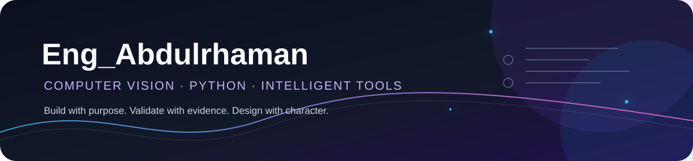

<div align="center">



<br>

<a href="https://github.com/Dev-KAIDO"></a>
<a href="https://www.python.org/"></a>
<a href="https://opencv.org/"></a>
<a href="https://github.com/Dev-KAIDO?tab=repositories"></a>

</div>

## Hello, I'm Abdulrhaman

I build **computer-vision systems, analytical tools, and thoughtful software experiences**. My work sits at the intersection of visual understanding, graph-based reasoning, Python engineering, and interfaces that make complex results easier to trust.

> **My standard:** preserve the evidence, validate the result, and make the next decision easier.

### What I am focused on

<table>
<tr>
<td width="25%" align="center"><h3>👁️</h3><strong>Vision</strong><br><sub>Images · OCR · diagrams</sub></td>
<td width="25%" align="center"><h3>🧠</h3><strong>Reasoning</strong><br><sub>Graphs · PERT · validation</sub></td>
<td width="25%" align="center"><h3>🛠️</h3><strong>Building</strong><br><sub>Python · tools · automation</sub></td>
<td width="25%" align="center"><h3>✨</h3><strong>Experience</strong><br><sub>Dashboards · bilingual UI</sub></td>
</tr>
</table>

<details>
<summary><strong>My engineering mindset</strong></summary>
<br>

```python
class Abdulrhaman:
    focus = [
        "Computer vision and OCR",
        "Graph algorithms and PERT / CPM",
        "Python engineering and automation",
        "Interactive tools and dashboards",
        "Arabic / English experiences",
    ]

    principle = "Validate first. Explain clearly. Design with purpose."
```

</details>

## Selected projects

<table>
<tr>
<td width="50%" valign="top">
<h3>📐 <a href="https://github.com/Dev-KAIDO/PERT-Critical-Path-Analyzer">PERT Critical Path Analyzer</a></h3>
<p>Reads PERT / CPM network diagrams, validates their structure, and turns them into useful project analysis.</p>
<a href="https://github.com/Dev-KAIDO/PERT-Critical-Path-Analyzer"></a>


</td>
<td width="50%" valign="top">
<h3>🧪 <a href="https://github.com/Dev-KAIDO/ChemLabX_Lite">ChemLabX Lite</a></h3>
<p>An offline-first virtual chemistry lab PWA designed for accessible, reliable bilingual learning.</p>
<a href="https://github.com/Dev-KAIDO/ChemLabX_Lite"></a>


</td>
</tr>
<tr>
<td width="50%" valign="top">
<h3>🔐 <a href="https://github.com/Dev-KAIDO/CryptoEdu-Pro">CryptoEdu Pro</a></h3>
<p>An interactive bilingual desktop application for learning classical and modern cryptography step by step.</p>
<a href="https://github.com/Dev-KAIDO/CryptoEdu-Pro"></a>

</td>
<td width="50%" valign="top">
<h3>🤖 <a href="https://github.com/Dev-KAIDO/agent-skills">Agent Skills</a></h3>
<p>A collection of reusable skills, workflows, and practical experiments for agentic software development.</p>
<a href="https://github.com/Dev-KAIDO/agent-skills"></a>

</td>
</tr>
</table>

## Technology constellation

<div align="center">

<a href="https://www.python.org/"></a>
<a href="https://isocpp.org/"></a>
<a href="https://dotnet.microsoft.com/languages/csharp"></a>
<a href="https://opencv.org/"></a>
<a href="https://www.qt.io/"></a>
<a href="https://developer.mozilla.org/en-US/docs/Web/JavaScript"></a>
<a href="https://git-scm.com/"></a>
<a href="https://github.com/"></a>

<br><br>


</div>

<details>
<summary><strong>How I work</strong></summary>
<br>

| Principle | In practice |
| --- | --- |
| **Evidence over guesses** | Keep the source evidence visible and make uncertainty explicit. |
| **Validation before calculation** | Verify structure before producing a confident-looking result. |
| **Useful complexity** | Make powerful workflows understandable when decisions matter. |
| **Focused improvement** | Fix the highest-impact bottleneck before adding noise. |

</details>

## GitHub

<div align="center">

<a href="https://github.com/Dev-KAIDO?tab=repositories"></a>
<a href="https://github.com/Dev-KAIDO/Eng_KAIDO"></a>

<br><br>


<br>

<strong>Build with purpose · Validate with evidence · Design with character</strong>

</div>
